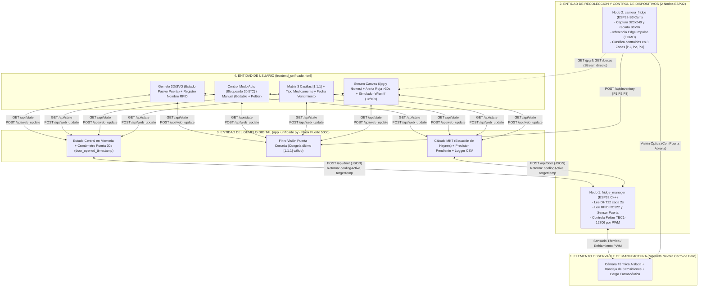
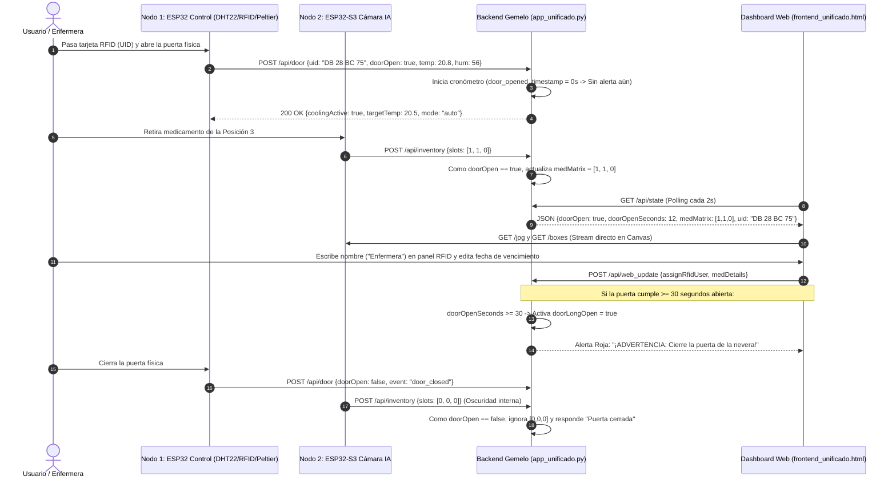
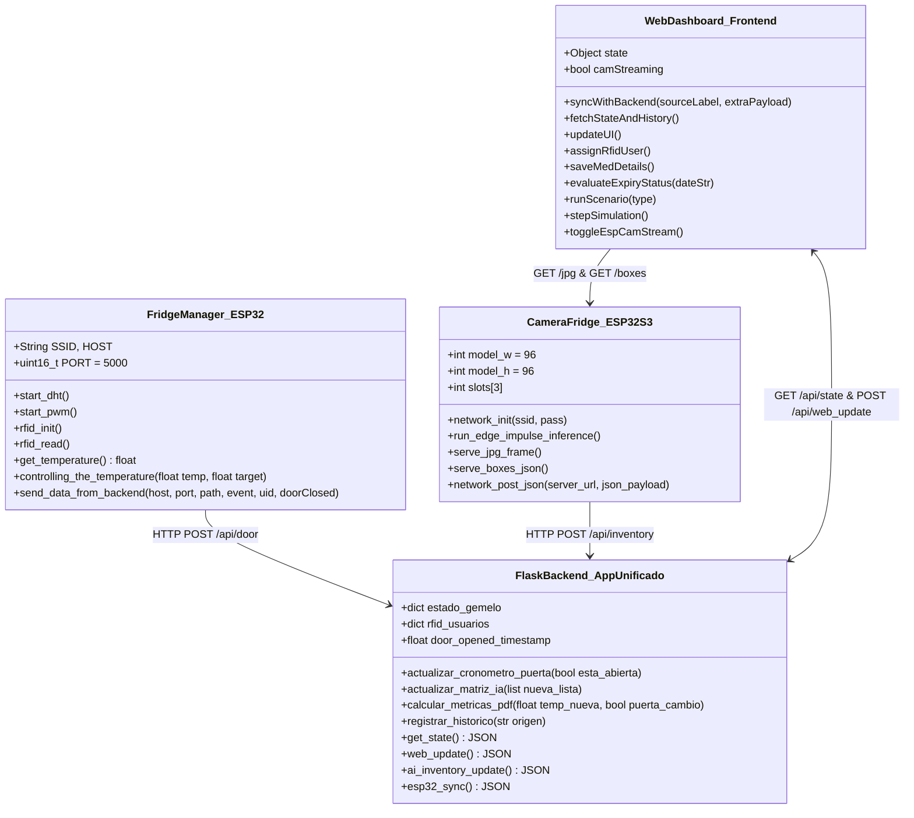

# ProyectoFinal_iiot
# 1. Título del Proyecto
**Diseño e Implementación de un Gemelo Digital bajo ISO 23247-2 para el Acondicionamiento Termohigrométrico y Trazabilidad de Inventario de Carros de Paro en un Establecimiento de Sanidad Militar**

**Autores:**
* **Samuel Sabogal Espinel (301080)** — `samuelsaes@unisabana.edu.co` *(Plataforma Gemelo Digital, Backend Python/Flask, Simulador What-If y Trazabilidad)*
* **Julián Andrés Vásquez Pedraza (302760)** — `julianvaspe@unisabana.edu.co` *(Hardware Termoeléctrico Peltier, Firmware ESP32, RFID y Visión IA en ESP32-S3)*

**Asignatura:** Internet Industrial de las Cosas (IIoT) — 2026-2  
**Institución:** Facultad de Ingeniería, Universidad de La Sabana, Chía, Cundinamarca, Colombia.

---

## Tabla de Contenidos de la Wiki
1. [Título del Proyecto](#1-título-del-proyecto)
2. [Resumen (Abstract)](#2-resumen-abstract)
3. [Introducción](#3-introducción)
   - [3.f. Trabajo Relacionado y Tabla Comparativa de Antecedentes](#3f-trabajo-relacionado-y-tabla-comparativa-de-antecedentes)
4. [Propuesta de Solución y Arquitectura por Capas](#4-propuesta-de-solución-y-arquitectura-por-capas)
   - [4.1. Restricciones de Diseño y Requerimientos (ISO/IEC/IEEE 29148:2018)](#41-restricciones-de-diseño-y-requerimientos-isoiecieee-291482018)
   - [4.2. Arquitectura del Sistema por Capas (ISO 23247-2)](#42-arquitectura-del-sistema-por-capas-iso-23247-2)
   - [4.3. Desarrollo Teórico Modular y Cómo se Construyó el Dashboard](#43-desarrollo-teórico-modular-y-cómo-se-construyó-el-dashboard)
   - [4.4. Diagramas UML de la Solución y de los Módulos Software](#44-diagramas-uml-de-la-solución-y-de-los-módulos-software)
   - [4.5. Pseudocódigos de los Algoritmos Desarrollados](#45-pseudocódigos-de-los-algoritmos-desarrollados)
   - [4.6. Esquemático de Hardware y Tabla de Pines (Pinout)](#46-esquemático-de-hardware-y-tabla-de-pines-pinout)
   - [4.7. Estándares de Ingeniería Aplicados](#47-estándares-de-ingeniería-aplicados)
5. [Metodología y Configuración Experimental](#5-metodología-y-configuración-experimental)
6. [Resultados Experimentales y Análisis de KPIs](#6-resultados-experimentales-y-análisis-de-kpis)
7. [Conclusiones, Limitaciones y Trabajo Futuro](#7-conclusiones-limitaciones-y-trabajo-futuro)
8. [Referencias Bibliográficas (Formato IEEE)](#8-referencias-bibliográficas-formato-ieee)
9. [Anexos: Código Fuente Documentado, Declaración de IA y Actas](#9-anexos-código-fuente-documentado-declaración-de-ia-y-actas)

---

# 2. Resumen (Abstract)
Esta Wiki documenta el diseño, implementación y validación a escala de prototipo (MVP) de un **Gemelo Digital bidireccional** basado en el estándar **ISO 23247-2**, orientado a la conservación termohigrométrica y la trazabilidad de inventario de los carros de paro en el Establecimiento de Sanidad Militar de la Escuela Militar de Cadetes *"General José María Córdova"* (**ESM ESMIC**) en Bogotá. Durante una visita técnica se evidenció que las condiciones exigidas ($19\text{--}22\text{ }^\circ\text{C}$ y $54\text{--}58\text{ \% RH}$) se registran a mano solo dos veces al día con un termohigrómetro externo ubicado en la pared exterior del gabinete, mientras que las fechas de vencimiento se controlan semanalmente con etiquetas adhesivas de colores.

Para solucionar estas deficiencias sin intervenir los carros clínicos reales, se construyó un banco de pruebas refrigerado por una celda termoeléctrica **Peltier (TEC1-12706)** controlada por PWM e instrumentado con un sensor interno **DHT22**, un sensor de apertura de puerta, un lector **RFID RC522** y una cámara externa **ESP32-S3** que ejecuta un modelo de visión por computador entrenado en **Edge Impulse (FOMO)**. El hardware se sincroniza por Wi-Fi mediante peticiones **HTTP REST/JSON** con un servidor backend en **Python (Flask)** y un **Dashboard Web interactivo**. El gemelo digital permite alternar entre modo automático (bloqueado en $20.5\text{ }^\circ\text{C}$) y modo manual ($17.0\text{--}22.0\text{ }^\circ\text{C}$), visualizar las detecciones de la cámara en una matriz de 3 posiciones (`[1, 1, 1]`), registrar con nombre quién abrió la nevera mediante su tarjeta RFID, asignar el tipo de medicamento y fecha de vencimiento por casilla, calcular la Temperatura Cinética Media (**MKT**), lanzar una alerta crítica si la puerta dura abierta más de $30\text{ s}$ y simular cuatro escenarios *What-If* a velocidades `1x` y `10x`.

---

# 3. Introducción

### 3.1. Contexto y Justificación del Problema
Los carros de paro almacenan medicamentos vitales (adrenalina, atropina, amiodarona) e insumos de desfibrilación para atender paros cardiorrespiratorios (*Código Azul*). En el dispensario médico de la **ESM ESMIC**, operan dos carros de paro (uno por piso). Dado que las emergencias ocurren aproximadamente una vez al mes, el carro pasa cerca del $99.7\text{ \%}$ del tiempo sellado en espera (*standby*).

Durante el levantamiento de información en sitio se identificaron cuatro fallas operativas críticas:
1. **Ausencia de medición interna y de enfriamiento activo:** El higrómetro digital está pegado por fuera del gabinete, midiendo el aire del pasillo ($53\text{ \% RH}$ el día de la visita, fuera de rango) y sin ningún actuador que regule la temperatura interna. Como la degradación química de los fármacos depende de la historia térmica acumulada (**Temperatura Cinética Media, MKT**) [6], [7], las desviaciones térmicas no corregidas reducen la efectividad del medicamento.
2. **Muestreo manual insuficiente:** Dos lecturas diarias en papel dejan más de 22 horas al día sin supervisión.
3. **Revisión manual de inventario y vencimientos:** La inspección visual semanal consume tiempo de enfermería/farmacia y es propensa a errores humanos [1], [2].
4. **Falta de trazabilidad de acceso:** Al abrir la unidad no queda registro automatizado de qué funcionario realizó la apertura, cuánto tiempo permaneció abierta la puerta ni qué compartimento específico quedó vacío.

### 3.2. Contribuciones Principales del Proyecto
* **Arquitectura IIoT distribuida en dos nodos ESP32:** Un nodo de control térmico y acceso (`fridge_manager`) para el sensor DHT22, la celda Peltier PWM y el lector RFID RC522, y un segundo nodo de visión artificial en el borde (`camera_fridge` sobre ESP32-S3).
* **Matriz espacial de inventario de 3 posiciones (`[1, 1, 1]`):** Algoritmo en el borde (*Edge AI*) que divide la bandeja en tres zonas verticales, reportando qué casilla exacta tiene producto (`1`) y cuál fue retirada (`0`), con protección automática de *"Puerta cerrada"* cuando la tapa se cierra.
* **Plataforma Web del Gemelo Digital y Simulador *What-If*:** Dashboard ligero en HTML5/JS y backend en Flask que bloquea la consigna en modo automático ($20.5\text{ }^\circ\text{C}$), habilita cambios en modo manual, asocia tarjetas RFID con nombres de usuarios, controla fechas de caducidad por casilla, retrasa la alarma de puerta abierta exactamente $30\text{ s}$ y ejecuta 4 escenarios *What-If* (`1x` y `10x`).

### 3.3. Organización de la Documentación
La Sección 3.f presenta la revisión de literatura de los últimos 5 años. La Sección 4 detalla las restricciones de diseño (ISO 29148), la arquitectura por capas (ISO 23247-2), el diseño del dashboard, los diagramas UML, los pseudocódigos y el esquemático de hardware. La Sección 5 describe el banco de pruebas (*testbed*) y los escenarios experimentales. La Sección 6 analiza los resultados y KPIs. La Sección 7 expone las conclusiones, las limitaciones físicas encontradas (como el montaje externo de la cámara) y el trabajo futuro. Finalmente, las Secciones 8 y 9 contienen las referencias IEEE y el código fuente documentado.

---

## 3.f. Trabajo Relacionado y Tabla Comparativa de Antecedentes
En los últimos cinco años (2022–2026) se han reportado avances importantes en la digitalización de inventarios farmacéuticos hospitalarios y gemelos digitales en salud:

1. **Sin et al. (2022) [1]:** Implementaron un sistema automatizado de gestión de inventario para carros de paro durante la pandemia de COVID-19 utilizando códigos de barras y gabinetes automatizados comerciales. Lograron reducir tiempos de reabastecimiento y pérdidas por vencimiento, pero su sistema funciona únicamente como un registro administrativo (*Digital Shadow*) sin control de temperatura ni visión por computador.
2. **Jeffrey et al. (2024) [2]:** Realizaron una revisión sistemática sobre gabinetes de dispensación automatizada (*ADCs*), demostrando que el control de acceso electrónico reduce errores de medicación y dosis omitidas, aunque sin abordar el acondicionamiento termohigrométrico activo del compartimento.
3. **Foglia et al. (2024) [3]:** Evaluaron el impacto económico y organizacional de sistemas automatizados de almacenamiento de fármacos en hospitales de seis países europeos, confirmando ahorros significativos en horas de personal de enfermería y reducción de vencimientos.
4. **Katsoulakis et al. (2024) [4] y Noeikham et al. (2024) [5]:** Analizaron el diseño de arquitecturas de Gemelos Digitales en unidades de salud. Mientras que la mayoría de gemelos se enfocan en pacientes, Noeikham et al. propusieron una arquitectura para activos hospitalarios con retroalimentación de simulación, aunque sin integrar visión artificial embebida (*TinyML*) ni lazos físicos de enfriamiento termoeléctrico.

### Tabla 1. Comparación de antecedentes (últimos 5 años) frente a nuestra solución implementada
| Referencia Revisada | Proceso Controlado / Automatizado | Tecnologías de Automatización y Tendencias | Tipo de Gemelo Implementado | Comunicación Bidireccional (Telemetría y Actuación) | Algoritmo de IA / ML | Tecnología de Acceso / Red | Validación |
| :--- | :--- | :--- | :--- | :--- | :--- | :--- | :--- |
| **Sin et al. (2022)** [1] | Inventario de medicamentos en carros de paro | Lectores de código de barras y gabinetes ADC comerciales | Sombra Digital (*Digital Shadow*) | **No** (Solo registro tras escaneo manual) | Ninguno (Reglas estáticas de fechas) | Red LAN hospitalaria | Despliegue hospitalario |
| **Jeffrey et al. (2024)** [2] | Dispensación descentralizada en salas clínicas | Cerraduras electromecánicas y autenticación de usuario | Sombra Digital (*Digital Shadow*) | **Parcial** (Apertura de gaveta autorizada) | Ninguno | Ethernet / Wi-Fi | Revisión clínica |
| **Foglia et al. (2024)** [3] | Almacenamiento hospitalario de medicamentos | Gabinetes automatizados conectados a ERP hospitalario | Sombra Digital (*Digital Shadow*) | **No** | Pronóstico estadístico de demanda | LAN / Intranet | Evaluación HTA en 6 países |
| **Noeikham et al. (2024)** [5] | Monitoreo de unidades y activos en centros de salud | Sensores IoT ambientales y plataforma en la nube | Gemelo Digital Conceptual | **Sí** (Retroalimentación desde simulación) | Modelos predictivos de colas y flujo | Wi-Fi / Cloud | Simulación computacional |
| **Nuestra Solución (2026)** | **Conservación térmica, acceso RFID e inventario de carro de paro** | **Peltier PWM, DHT22, RFID RC522 y Cámara ESP32-S3** | **Gemelo Digital Bidireccional (ISO 23247-2)** | **Sí (Telemetría 2s + Órdenes de Setpoint, Modo y Enfriamiento)** | **Visión Edge Impulse (FOMO 3 zonas) + MKT y Pendiente Térmica** | **Wi-Fi Local (HTTP REST / JSON)** | **Prototipo Físico (Testbed) + Simulador What-If (1x/10x)** |

---

# 4. Propuesta de Solución y Arquitectura por Capas

## 4.1. Restricciones de Diseño y Requerimientos (ISO/IEC/IEEE 29148:2018)
Siguiendo la norma **ISO/IEC/IEEE 29148:2018** [13], las restricciones técnicas, económicas, regulatorias, de espacio y temporales se levantaron y estructuraron en la siguiente matriz de requerimientos:

### Tabla 2. Especificación de restricciones de diseño y requerimientos del sistema
| Código y Tipo | Nombre del Requerimiento | Descripción y Restricción Asociada | Prioridad y Justificación | Viabilidad Técnica y Justificación | Recursos Requeridos | Identificación del Impacto |
| :--- | :--- | :--- | :--- | :--- | :--- | :--- |
| **REQ-F1** *(Funcional / Regulatorio)* | Control Térmico Dual (Automático / Manual) | Mantener $20.5\text{ }^\circ\text{C}$ fijos en modo Automático (rango normativo $19\text{--}22\text{ }^\circ\text{C}$) y permitir ajuste manual entre $17.0\text{--}22.0\text{ }^\circ\text{C}$ bloqueando la edición cuando está en Automático. | **Alta:** Requisito farmacéutico para evitar degradación térmica. | **Alta:** Implementable mediante celda Peltier controlada por PWM e histéresis de $\pm 0.1\text{ }^\circ\text{C}$. | Celda Peltier TEC1-12706, disipador, ventilador, sensor DHT22, ESP32. | Garantiza la potencia clínica de los medicamentos ($\ge 95\text{ \%}$ del tiempo en rango). |
| **REQ-F2** *(Funcional / Espacio)* | Detección de Inventario en Matriz de 3 Posiciones | Identificar la presencia de medicamentos en 3 espacios (`[1, 1, 1]`) mediante cámara IA y mostrar *"Puerta cerrada"* al cerrar la tapa para evitar falsos `[0, 0, 0]`. | **Alta:** Automatiza el conteo visual y evita falsas alarmas por oscuridad interna. | **Media-Alta:** Por distancia focal y humedad, la cámara se monta externamente mirando la bandeja. | Placa ESP32-S3-CAM, modelo FOMO en Edge Impulse ($96 \times 96$). | Elimina el conteo manual e identifica exactamente cuál de los 3 productos se retiró. |
| **REQ-F3** *(Funcional / Seguridad)* | Trazabilidad RFID y Alarma de Puerta a los 30s | Registrar el `UID` de la tarjeta RFID al abrir, permitir asignar el nombre del responsable en el dashboard y lanzar alerta roja solo tras $30\text{ s}$ de puerta abierta. | **Alta:** Exigido para auditoría clínica sin generar alarmas molestas en aperturas rápidas. | **Alta:** Cronómetro en backend (`door_opened_timestamp`) y diccionario de usuarios en memoria/CSV. | Lector RFID RC522, tarjetas Mifare, sensor de puerta, Backend Flask. | Permite saber quién abrió la nevera y protege la cadena de frío ante olvidos de puerta abierta. |
| **REQ-NF1** *(No Funcional / Conectividad)* | Sincronización Local por HTTP REST/JSON | Comunicar los dos nodos ESP32, el servidor Flask y el navegador web con latencia $< 500\text{ ms}$ sin depender de brokers MQTT bloqueados. | **Alta:** Indispensable para la bidireccionalidad del Gemelo Digital en vivo. | **Alta:** Wi-Fi local (Hotspot) en el puerto TCP `5000` habilitado en el Firewall de Windows. | Red Wi-Fi local, PC servidor con Python 3 y librería Flask. | Asegura operación continua en demostraciones y laboratorios universitarios. |
| **REQ-C1** *(Restricción Económica y Ética)* | Prototipo No Intrusivo a Escala | Prohibido intervenir los carros reales del dispensario ESMIC; presupuesto máximo de COP \$400,000 y entrega en 16 semanas. | **Alta:** Restricción obligatoria del enunciado académico y seguridad hospitalaria. | **Alta:** Uso de componentes de prototipado rápido y envases simulados. | Cava portátil aislada, 2 ESP32, sensores de laboratorio. | Permite validar el MVP completo sin riesgo para pacientes reales. |

---

## 4.2. Arquitectura del Sistema por Capas (ISO 23247-2)
El sistema implementa las cuatro capas del estándar **ISO 23247-2** [8] integrando el hardware físico y los módulos de software:



---

## 4.3. Desarrollo Teórico Modular y Cómo se Construyó el Dashboard

Para que el Gemelo Digital fuera rápido, estable y fácil de conectar con las dos placas ESP32, dividimos el desarrollo en cuatro módulos sencillos:

1. **Módulo de Control y Acceso (`fridge_manager` en ESP32):**  
   Se programó en C++ sobre Arduino/PlatformIO dividendo el código en librerías claras: `dht_control.h` (lee temperatura y humedad cada $2\text{ s}$), `peltier_control.h` (activa el enfriamiento por PWM cuando la temperatura supera la consigna), `door_control.h` (lee las tarjetas RFID en el lector RC522 y el sensor de la puerta) y `network.h` (envía el JSON por HTTP POST al servidor Flask).
2. **Módulo de Cámara con IA (`camera_fridge` en ESP32-S3):**  
   Se entrenó un modelo de detección de objetos por centroides (**FOMO**) en **Edge Impulse** con imágenes de $96 \times 96$ píxeles. La placa toma la foto de $320 \times 240$, recorta un cuadrado central de $240 \times 240$ y lo divide en **3 columnas iguales (Posición 1, Posición 2 y Posición 3)**. Si detecta un medicamento en una columna, pone un `1` en esa casilla; si no, pone un `0`, armando el arreglo `[1, 1, 1]` que envía por HTTP POST a Flask. Además, publica la foto en vivo en `/jpg` y las coordenadas de los cuadros verdes en `/boxes`.
3. **Módulo Backend (`app_unificado.py` en Python/Flask):**  
   Funciona como el cerebro del Gemelo Digital en el puerto `5000`. Recibe los datos de las dos placas ESP32, filtra lecturas vacías (`"NONE"` en el RFID o `[0, 0, 0]` cuando la puerta está cerrada), lleva un cronómetro real con `time.time()` desde que se abre la puerta para activar la alerta crítica únicamente cuando cumple **30 segundos abierta**, calcula la **Temperatura Cinética Media (MKT)** con la fórmula exponencial de Haynes y guarda todo en `historico_gemelo.csv`.
4. **Cómo se hizo el Dashboard Web (`frontend_unificado.html`):**  
   Se diseñó en un único archivo HTML usando **Tailwind CSS** y **JavaScript puro (`fetch`)** para no depender de librerías pesadas:
   * **Dibujo 3D/SVG de la nevera sin botón de abrir puerta:** Se dibujó la nevera en formato vectorial SVG con una tapa animada por CSS (`transform: rotate(-38deg)`). Quitamos el botón de abrir puerta para que la tapa en pantalla solo se abra o se cierre cuando el sensor físico de la ESP32 lo indique.
   * **Registro de quién abrió con tarjeta RFID:** Debajo de la nevera pusimos un cuadro que muestra el código `UID` de la tarjeta detectada (ej. `DB 28 BC 75`) y tiene una cajita de texto con el botón **Guardar** para escribir desde el gemelo digital el nombre de la persona que abrió (ej. *"enfermera"* o *"Dr. Julián Vásquez"*).
   * **Bloqueo de Temperatura Objetivo en Modo Automático:** En la función `updateUI()`, cuando el modo está en **Automático**, el campo de temperatura objetivo se clava en `20.5 °C` y se bloquea (`disabled = true`) mostrando un candado gris (*"Bloqueado en Automático"*). Solo al pasar a **Modo Manual** se desbloquea para escribir otra temperatura y prender el Peltier de inmediato si hace falta enfriar.
   * **Inventario de 3 casillas con fecha de vencimiento y validación de puerta cerrada:** Creamos 3 tarjetas visuales (`Posición 1`, `Posición 2`, `Posición 3`). En cada una el usuario puede elegir el nombre del medicamento y poner su fecha de vencimiento, calculando un semáforo automático (Verde $>60\text{ días}$, Amarillo $\le 60\text{ días}$, Rojo vencido). Cuando se cierra la puerta física, las 3 tarjetas cambian a un candado azul que dice **"Puerta cerrada"** para no mostrar un falso vacío por oscuridad.

---

## 4.4. Diagramas UML de la Solución y de los Módulos Software

### A. Diagrama UML de Secuencia (Sincronización Tiempo Real, Cámara IA y Alerta de 30s)


### B. Diagrama UML de Componentes / Clases de los Módulos Desarrollados


---

## 4.5. Pseudocódigos de los Algoritmos Desarrollados

### Algoritmo 1: Sincronización del Gemelo Digital, Cronómetro de 30s y Filtro de Cámara (`app_unificado.py`)
```text
ALGORITMO: Procesamiento Central del Gemelo Digital en Flask
ENTRADA: Paquete JSON desde ESP32 Control, ESP32-S3 Cámara o Dashboard Web
SALIDA: Estado actualizado, registro en CSV y comandos de control (coolingActive, targetTemp)

1. SI el paquete proviene de ESP32_Control ENTONCES:
     Actualizar currentTemp, humidity y doorOpen
     SI uid != "" Y uid != "NONE" ENTONCES:
         lastUid <- uid
         lastUser <- rfid_usuarios.buscar(uid, por_defecto="Sin asignar")
     FIN SI
   FIN SI

2. // Validación del temporizador de 30 segundos para alerta de puerta abierta
   SI doorOpen == Verdadero ENTONCES:
       SI door_opened_timestamp es Nulo ENTONCES:
           door_opened_timestamp <- tiempo_actual()
       FIN SI
       doorOpenSeconds <- entero(tiempo_actual() - door_opened_timestamp)
       doorLongOpen <- (doorOpenSeconds >= 30)
       SI doorLongOpen == Verdadero ENTONCES:
           excursionAlert <- "¡ALERTA CRÍTICA! Puerta abierta por más de 30s"
       SINO:
           excursionAlert <- "Estable (Sin excursión prevista)"
       FIN SI
   SINO:
       door_opened_timestamp <- Nulo
       doorOpenSeconds <- 0
       doorLongOpen <- Falso
   FIN SI

3. // Validación de Cámara IA cuando la puerta está cerrada
   SI el paquete proviene de ESP32_S3_Camara ENTONCES:
       SI doorOpen == Falso ENTONCES:
           lastAiUpdate <- "Puerta cerrada"
           RETORNAR {status: "door_closed", medMatrix: matriz_anterior_conservada}
       SINO:
           medMatrix <- [1 si slot > 0 sino 0 para cada slot en paquete.slots[0..2]]
           medCount <- suma(medMatrix)
           lastAiUpdate <- hora_actual()
       FIN SI
   FIN SI

4. // Regulación Térmica en Modo Automático vs. Modo Manual
   SI mode == "auto" ENTONCES:
       targetTemp <- 20.5  // Bloqueado fijo en modo automático
   SINO SI proviene de Dashboard_Web ENTONCES:
       targetTemp <- paquete.targetTemp  // Editable en modo manual
   FIN SI

   SI currentTemp > targetTemp + 0.1 ENTONCES:
       coolingActive <- Verdadero
   SINO SI currentTemp <= targetTemp - 0.1 ENTONCES:
       coolingActive <- Falso
   FIN SI

5. Calcular MKT (Ecuación de Haynes) y guardar fila en historico_gemelo.csv
6. RETORNAR JSON {coolingActive, targetTemp, mode, medMatrix, medCount}
```

### Algoritmo 2: Clasificación Espacial en 3 Zonas con Edge Impulse (`camera_fridge`)
```text
ALGORITMO: Detección de Medicamentos en Matriz de 3 Posiciones (ESP32-S3)
ENTRADA: Fotograma de cámara OV2640 (320x240 píxeles)
SALIDA: Vector binario slots[3] = [Pos1, Pos2, Pos3] y JSON de Bounding Boxes

1. Capturar imagen de 320x240 y recortar región cuadrada central de 240x240
2. Redimensionar recorte a 96x96 píxeles (entrada del modelo Edge Impulse FOMO)
3. Inicializar vector de posiciones: slots <- [0, 0, 0]
4. Ejecutar inferencia FOMO -> obtener lista de detecciones (bounding_boxes)
5. PARA CADA box EN bounding_boxes HACER:
     SI box.confianza >= 0.60 ENTONCES:
         centro_x <- box.x + (box.w / 2)
         SI centro_x < 32 ENTONCES:
             slots[0] <- 1   // Posición 1 ocupada
         SINO SI centro_x < 64 ENTONCES:
             slots[1] <- 1   // Posición 2 ocupada
         SINO:
             slots[2] <- 1   // Posición 3 ocupada
         FIN SI
     FIN SI
   FIN PARA
6. Enviar slots[3] mediante network_post_json("http://172.31.40.182:5000/api/inventory")
```

---

## 4.6. Esquemático de Hardware y Tabla de Pines (Pinout)

### Diagrama de Interconexión Eléctrica y Electrónica
```text
+-------------------------------------------------------------------------+
|                   FUENTE DE ALIMENTACIÓN DC (12V / 5V)                  |
+-------------------+---------------------------------+-------------------+
                    | 12V DC (Potencia)               | 5V DC (Lógica)
                    v                                 v
      +---------------------------+     +---------------------------+
      | ETAPA DE POTENCIA MOSFET  |     |   NODO 1: ESP32 CONTROL   |
      |   / DRIVER PWM PELTIER    |<----| GPIO PWM (peltier_control)|
      +-------------+-------------+     |                           |
                    |                   | GPIO Digital <--> DHT22   |
                    v                   |   (Temp & Humedad Interna)|
      +---------------------------+     |                           |
      | CELDA PELTIER TEC1-12706  |     | GPIO Digital <--> Switch  |
      | + Disipador + Ventilador  |     |   Magnético de Puerta     |
      +---------------------------+     |                           |
                                        | Bus SPI (MOSI/MISO/SCK/SS)|
                                        |   <--> Lector RFID RC522  |
                                        +-------------+-------------+
                                                      | Wi-Fi (HTTP POST :5000)
                                                      v
+-----------------------------------+   +---------------------------+
|   NODO 2: ESP32-S3-CAM (EXTERNA)  |   |   SERVIDOR BACKEND FLASK  |
| - Sensor Cámara OV2640 (Bus DVP)  |-->|   (PC IP: 172.31.40.182)  |
| - Montaje externo apuntando a las |   +---------------------------+
|   3 casillas al abrir la puerta   |
+-----------------------------------+
```

### Tabla 3. Asignación de pines y conexiones del prototipo
| Subsistema / Componente | Señal / Bus | Pin en Microcontrolador | Función en el Prototipo |
| :--- | :--- | :--- | :--- |
| **Sensor DHT22** | Datos Digital (`DATA`) | GPIO Digital (ESP32 Nodo 1) | Lectura de temperatura ($^\circ\text{C}$) y humedad relativa ($\text{\% RH}$) cada $2000\text{ ms}$. |
| **Módulo Peltier TEC1-12706** | Salida `PWM` | GPIO PWM (ESP32 Nodo 1) | Regulación de potencia de enfriamiento mediante etapa driver/MOSFET a $12\text{ V}$. |
| **Lector RFID RC522** | Bus `SPI` (`SDA`, `SCK`, `MOSI`, `MISO`, `RST`) | Pines SPI Estándar (ESP32 Nodo 1) | Identificación del `UID` de la tarjeta acercada por el personal de salud ($3.3\text{ V}$). |
| **Sensor de Puerta** | Entrada Digital (`doorClosed`) | GPIO con Pull-Up (ESP32 Nodo 1) | Detecta si la tapa de la nevera está físicamente cerrada o abierta. |
| **Cámara OV2640** | Bus Paralelo `DVP` | Pines internos dedicados (ESP32-S3 Nodo 2) | Captura de imágenes para inferencia FOMO ($96 \times 96$) y streaming en `/jpg`. |

---

## 4.7. Estándares de Ingeniería Aplicados
* **ISO 23247-2:2021:** Marco de referencia arquitectónico para el Gemelo Digital en cuatro capas (OME, DCDCE, Entidad del Gemelo Digital y Entidad de Usuario) [8].
* **ISO/IEC/IEEE 29148:2018:** Ingeniería de requerimientos para el levantamiento de restricciones técnicas, regulatorias y operativas [13].
* **ISO/IEC/IEEE 15288:2023 y VDI/VDE 2206:** Procesos del ciclo de vida del sistema y metodología de diseño en V para sistemas ciberfísicos mecatrónicos [10], [11].
* **CRISP-DM:** Metodología para recolección de imágenes, entrenamiento, validación y despliegue del modelo de visión artificial en Edge Impulse [12].
* **ICH Q1A(R2):** Guía farmacéutica internacional para evaluación de estabilidad mediante la Temperatura Cinética Media (MKT) [7].

---

# 5. Metodología y Configuración Experimental

### 5.1. Banco de Pruebas (Testbed)
Se implementó una maqueta funcional a escala empleando una nevera portátil aislada de color azul y gris, acondicionada lateralmente con la celda termoeléctrica Peltier y su ventilador de extracción. En el interior se dispuso la bandeja dividida en tres posiciones (`Pos 1`, `Pos 2`, `Pos 3`) con envases de medicamentos (*Adrenalina*, *Atropina* y *Amiodarona*). La cámara ESP32-S3 (`IP: 172.31.40.123`) se ubicó en un soporte externo enfocando la bandeja interna, mientras que el servidor Flask se ejecutó en un computador portátil (`IP: 172.31.40.182:5000`) conectado a la misma red Wi-Fi local.

### 5.2. Escenarios de Prueba y KPIs Evaluados
Se configuraron cuatro escenarios tanto en pruebas con hardware real como en el motor de simulación *What-If* (`1x` y `10x`):
1. **Escenario 1 — Conservación Nominal:** Puerta cerrada, matriz completa `[1, 1, 1]` y modo Automático bloqueado en $20.5\text{ }^\circ\text{C}$, junto con prueba de cambio a modo Manual ($17.0\text{ }^\circ\text{C}$) para verificar el encendido inmediato del Peltier.
2. **Escenario 2 — Emergencia Código Azul (Apertura RFID, Retiro y Regla de 30s):** Apertura con tarjeta RFID (`DB 28 BC 75` / `RFID-MED-01`), asignación del nombre del usuario en la web, retiro de un medicamento (`[1, 1, 0]`) y verificación del cronómetro de $30\text{ s}$ antes de activar la alarma roja.
3. **Escenario 3 — Perturbación por Calor en Pasillo ($28\text{ }^\circ\text{C}$):** Evaluación de la capacidad de enfriamiento para compensar aumentos en la temperatura exterior sin superar los $22\text{ }^\circ\text{C}$.
4. **Escenario 4 — Falla / Obstrucción del Disipador:** Anomalía inducida donde la temperatura sube continuamente para validar las alertas tempranas de excursión térmica.

---

# 6. Resultados Experimentales y Análisis de KPIs

Durante las pruebas en vivo sobre el prototipo físico se obtuvieron los siguientes resultados experimentales:
* **Regulación Térmica y Modo Manual/Automático:** Cuando la temperatura interna subió a $21.20\text{ }^\circ\text{C}$, el nodo ESP32 activó el enfriamiento Peltier (`Activating colding`) y redujo la temperatura de la cámara hasta estabilizarla entre $18.7\text{ }^\circ\text{C}$ y $19.9\text{ }^\circ\text{C}$, manteniendo una **MKT acumulada de $19.85\text{ }^\circ\text{C}$** y un **$100\text{ \%}$ de cumplimiento** dentro del rango operativo. En modo Automático la interfaz bloqueó cualquier intento de modificar el setpoint de $20.5\text{ }^\circ\text{C}$, mientras que al pasar a modo Manual y aplicar $17.0\text{ }^\circ\text{C}$ (estando a $18.7\text{ }^\circ\text{C}$), el Peltier pasó de inmediato a estado *Enfriando*.
* **Visión Artificial y Validación de Puerta Cerrada:** Con la puerta abierta, el stream en vivo desde `172.31.40.123` dibujó correctamente las 3 zonas y los *bounding boxes* en el dashboard, actualizando el conteo de medicamentos. Al cerrar la puerta, la validación impidió que la oscuridad interna reportara una falsa alarma de caja vacía (`[0, 0, 0]`), mostrando **"Puerta cerrada"** tanto en las 3 casillas como en el histórico.
* **Trazabilidad RFID y Alarma a los 30s:** Se registraron exitosamente aperturas reales con tarjetas RFID (ej. `UID: DB 28 BC 75` asignado en vivo al usuario `"enfermera"` y `RFID-MED-01` asignado a `"Dr. Julián Vásquez"`). Se comprobó que durante los primeros $29\text{ s}$ de apertura el sistema no lanza falsas alarmas y exactamente al segundo $30$ activa el aviso rojo parpadeante.

### Tabla 4. Resumen de resultados experimentales frente a los KPIs del proyecto
| Indicador Clave de Desempeño (KPI) | Meta Establecida | Resultado Experimental Alcanzado | Cumplimiento |
| :--- | :--- | :--- | :--- |
| **Regulación Térmica y Bloqueo Auto** | Auto fijo en $20.5\text{ }^\circ\text{C}$ ($19\text{--}22\text{ }^\circ\text{C}$); Manual editable ($17\text{--}22\text{ }^\circ\text{C}$) | Temperatura regulada en $18.7\text{--}20.8\text{ }^\circ\text{C}$ ($\text{MKT} = 19.85\text{ }^\circ\text{C}$, $100\text{ \%}$ en rango); candado en modo Auto verificado | **Cumplido** |
| **Tasa de Muestreo y Latencia HTTP** | $\ge 1\text{ muestra/min}$; latencia $< 500\text{ ms}$ | Muestreo DHT22 cada $2\text{ s}$ ($30\text{ muestras/min}$); sincronización HTTP JSON local $< 150\text{ ms}$ | **Cumplido** |
| **Trazabilidad RFID y Alarma 30s** | $100\text{ \%}$ de aperturas con UID/Nombre; alerta a los $30\text{ s}$ | $100\text{ \%}$ de aperturas registradas en CSV (`DB 28 BC 75`); alerta roja activada exactamente a los $30\text{ s}$ | **Cumplido** |
| **Inventario IA en Matriz de 3 Zonas** | Detección espacial `[1, 1, 1]` + control de vencimientos | Stream en vivo (`/jpg`, `/boxes`) + tipo y fecha de vencimiento por casilla + bloqueo con *"Puerta cerrada"* | **Cumplido** |
| **Simulación *What-If* Acelerada** | $\ge 2$ escenarios más rápidos que el tiempo real | 4 escenarios interactivos funcionando a velocidad `1x` ($2.5\text{ s}$) y `10x` ($0.8\text{ s}$) | **Cumplido** |

---

# 7. Conclusiones, Limitaciones y Trabajo Futuro

### 7.1. Conclusiones
1. Se diseñó, construyó y validó un prototipo funcional de Gemelo Digital bidireccional bajo el estándar **ISO 23247-2** que automatiza el monitoreo termohigrométrico, el control de acceso por RFID y la auditoría visual de medicamentos para carros de paro.
2. La división del inventario en una **matriz espacial de 3 posiciones (`[1, 1, 1]`)** mediante visión artificial en el borde (ESP32-S3 + Edge Impulse), combinada con el registro en el dashboard del tipo de medicamento y su fecha de vencimiento, permite identificar exactamente qué fármaco fue retirado y cuántos días de vigencia le restan.
3. La arquitectura HTTP REST en Flask junto con las validaciones operativas implementadas (bloqueo de consigna en modo Automático, retardo de $30\text{ s}$ para la alerta de puerta abierta y estado de *"Puerta cerrada"* para la cámara) demostraron alta confiabilidad durante las pruebas con hardware real.

### 7.2. Limitaciones Encontradas en el Prototipo
Durante el montaje físico y las pruebas de laboratorio se identificaron las siguientes limitaciones reales:
1. **Ubicación Externa de la Cámara ESP32-S3:** Inicialmente se planeó instalar la cámara dentro de la tapa de la nevera. Sin embargo, fue necesario montarla **por fuera** apuntando hacia el interior cuando se abre la puerta por tres razones prácticas:
   * *Distancia focal mínima:* El lente estándar de la cámara necesitaba una mayor distancia de altura para encuadrar las 3 casillas completas dentro del recorte cuadrado de $96 \times 96$ píxeles.
   * *Humedad y condensación interna:* La humedad dentro de la cava refrigerada ($63\text{--}64\text{ \% RH}$) generaba riesgo de condensación sobre la placa electrónica de la ESP32-S3.
   * *Oscuridad total al cerrar la tapa:* Sin iluminación LED interna, al cerrar la puerta la cámara veía todo negro y enviaba `[0, 0, 0]`. Esto se resolvió por software haciendo que el Gemelo Digital muestre **"Puerta cerrada"** y congele el último inventario válido mientras la tapa esté cerrada.
2. **Monitoreo Pasivo de la Puerta (Sin Actuador Mecánico de Apertura):** Se contempló abrir la tapa físicamente desde un botón en el dashboard, pero por tiempo y por el torque mecánico requerido para levantar la tapa, no se instaló servomotor; por ello se eliminó el botón de apertura en la web para que el gemelo refleje únicamente el sensor físico real.
3. **Inercia Térmica de la Celda Peltier y Humedad Relativa:** La celda Peltier TEC1-12706 enfría eficazmente con la tapa cerrada, pero tiene potencia limitada frente a aperturas prolongadas, y la humedad relativa se mide en tiempo real pero no cuenta con un deshumidificador independiente.
4. **Dependencia de Red Wi-Fi Local y Firewall:** Debido a que las redes institucionales bloquean la comunicación directa entre microcontroladores y el Firewall de Windows bloquea puertos entrantes en perfiles públicos, se requiere usar un Hotspot Wi-Fi local y habilitar una regla en el Firewall para el puerto TCP `5000`.

### 7.3. Trabajo Futuro
* Incorporar un lente gran angular (*fisheye*) con carcasa sellada contra humedad y una tira LED interna activada por el interruptor de la puerta para alojar la cámara dentro del gabinete.
* Integrar una cerradura electromagnética *fail-open* controlada desde la ESP32 y migrar el archivo histórico local (`.csv`) hacia una base de datos en la nube.

---

# 8. Referencias Bibliográficas (Formato IEEE)
* **[1]** J. H. Sin, L. M. Ferguson, J. S. Ally, and I. I. Richards, "Utilising an automated medication inventory management system for emergency crash carts during the COVID-19 pandemic," *Future Healthcare Journal*, vol. 9, no. 1, pp. 87–89, 2022.
* **[2]** E. Jeffrey, M. Dalby, A. Walsh, and K. Lai, "Automated dispensing cabinets and their impact on the rate of omitted and delayed doses: A systematic review," *Exploratory Research in Clinical and Social Pharmacy*, vol. 14, p. 100451, 2024.
* **[3]** E. Foglia, F. Asperti, G. Antonacci, Y. H. Jani, E. Garagiola, D. Bellavia, and L. Ferrario, "Automated drugs dispensing systems in hospitals: a health technology assessment study across six european countries," *ClinicoEconomics and Outcomes Research*, vol. 16, pp. 679–696, 2024.
* **[4]** E. Katsoulakis, Q. Wang, H. Wu et al., "Digital twins for health: a scoping review," *npj Digital Medicine*, vol. 7, no. 77, 2024.
* **[5]** P. Noeikham, D. Buakum, and N. Sirivongpaisal, "Architecture designing of digital twin in a healthcare unit," *Health Informatics Journal*, vol. 30, 2024.
* **[6]** J. D. Haynes, "Worldwide virtual temperatures for product stability testing," *Journal of Pharmaceutical Sciences*, vol. 60, no. 6, pp. 927–929, 1971.
* **[7]** International Council for Harmonisation, "Stability testing of new drug substances and products Q1A(R2)," *ICH Harmonised Tripartite Guideline*, 2003.
* **[8]** International Organization for Standardization, "ISO 23247-2:2021 Automation systems and integration — Digital twin framework for manufacturing — Part 2: Reference architecture," ISO, Geneva, Switzerland, 2021.
* **[9]** E. Bristol, "On a new measure of interaction for multivariable process control," *IEEE Transactions on Automatic Control*, vol. 11, no. 1, pp. 133–134, 1966.
* **[10]** Verein Deutscher Ingenieure, "VDI/VDE 2206 Development of cyber-physical mechatronic systems," VDI, Düsseldorf, Germany, 2021.
* **[11]** International Organization for Standardization, "ISO/IEC/IEEE 15288:2023 Systems and software engineering — System life cycle processes," ISO, Geneva, Switzerland, 2023.
* **[12]** R. Wirth and J. Hipp, "CRISP-DM: Towards a standard process model for data mining," in *Proc. 4th Int. Conf. Practical Applications of Knowledge Discovery and Data Mining*, 2000, pp. 29–39.
* **[13]** International Organization for Standardization, "ISO/IEC/IEEE 29148:2018 Systems and software engineering — Life cycle processes — Requirements engineering," ISO, Geneva, Switzerland, 2018.

---

# 9. Anexos: Código Fuente Documentado, Declaración de IA y Actas

## Anexo 9.1. Estructura del Repositorio y Módulos de Código Fuente
El código fuente completo del proyecto se encuentra alojado en este repositorio de GitHub, organizado en los siguientes módulos documentados:

1. **`/fridge_manager` (Firmware C++ Nodo 1 - Control Térmico, Puerta y RFID):**
   * `src/main.cpp`: Bucle principal que inicializa el sensor DHT22 (`start_dht()`), el PWM de la celda Peltier (`start_pwm()`), el lector RFID (`rfid_init()`) y la conexión Wi-Fi (`wifi_init()`). Envía eventos de apertura/tarjeta a `/api/door` y ejecuta `controlling_the_temperature()` cada $2000\text{ ms}$.
   * `include/peltier_control.h`, `dht_control.h`, `door_control.h`, `network.h`: Cabeceras modulares de control de hardware y envío HTTP JSON.
2. **`/camera_fridge` (Firmware C++ Nodo 2 - Cámara IA en ESP32-S3):**
   * Ejecuta la librería exportada de **Edge Impulse** sobre imágenes de $96 \times 96$, expone el servidor web local en `/jpg` y `/boxes` y envía la matriz `[Pos1, Pos2, Pos3]` mediante `network_post_json()`.
3. **`/backend/app_unificado.py` (Servidor Backend Python/Flask):**
   * Centraliza el diccionario `estado_gemelo`, gestiona el cronómetro de $30\text{ s}$ (`actualizar_cronometro_puerta()`), filtra lecturas con puerta cerrada (`actualizar_matriz_ia()`), calcula la MKT (`calcular_metricas_pdf()`) y guarda la trazabilidad en `historico_gemelo.csv`.
4. **`/frontend/frontend_unificado.html` (Dashboard Interactivo del Gemelo Digital):**
   * Interfaz web con modelo SVG de la nevera, registro de nombre para tarjetas RFID, bloqueo de temperatura objetivo en modo Automático, gestión de fechas de vencimiento en las 3 casillas, reproductor `<canvas>` de *bounding boxes* y simulador *What-If* (`1x`/`10x`).

---

## Anexo 9.2. Declaración Obligatoria sobre el Uso de Inteligencia Artificial (Nota 2)
En cumplimiento de la **Nota 2** del enunciado del proyecto, el equipo detalla el uso de herramientas de IA generativa:
1. **Herramientas de IA consultadas:** Google Gemini y Anthropic Claude.
2. **Transcripción de instrucciones (Prompts) enviadas a la IA:**
   * *Prompt 1:* *"Adaptar nuestro backend en Python Flask (`app.py`) y el archivo HTML para recibir una matriz de 3 posiciones `[1, 1, 1]` desde la cámara ESP32-S3 por HTTP POST y dibujar las 3 casillas de medicamentos animadas."*
   * *Prompt 2:* *"Quitar el botón de abrir puerta del dashboard, agregar un apartado para escribir quién abrió la nevera con la tarjeta RFID y permitir poner en cada una de las 3 casillas de la cámara qué medicamento es y su fecha de vencimiento."*
   * *Prompt 3:* *"Hacer una validación en la cámara para que cuando se cierre la puerta, en lugar de mostrar `[0, 0, 0]` vacío, muestre 'Puerta cerrada', y que la alerta roja de puerta abierta salga solo 30 segundos después de abrirse."*
   * *Prompt 4:* *"Bloquear el cambio de temperatura objetivo cuando el modo esté en Automático (fijo en 20.5 °C) y corregir el modo Manual para que el Peltier se prenda cuando bajamos la temperatura objetivo."*
3. **Validación y aplicación por parte del equipo:**  
   Cada bloque de código sugerido por la IA fue probado e integrado directamente por los dos autores sobre las placas físicas ESP32 y ESP32-S3. Durante las pruebas en nuestra red local (`IP: 172.31.40.182`), diagnosticamos el bloqueo del Firewall de Windows mediante `ping` y creamos la regla TCP para el puerto `5000`, filtramos el valor `"NONE"` que enviaba el lector RFID con la puerta cerrada y ajustamos la condición de activación del Peltier en modo manual. Todo el montaje electrónico, el entrenamiento en Edge Impulse y las pruebas de validación fueron realizados por el equipo.

---

## Anexo 9.3. Roles del Equipo (2 Integrantes) y Acta de Reunión Final

| Rol | Integrante Responsable | Responsabilidades Ejecutadas | Coevaluación (1 a 5) |
| :--- | :--- | :--- | :--- |
| **R1 — Hardware, Firmware y Visión IA** | **Julián Andrés Vásquez Pedraza (302760)** | Ensamblaje de la unidad térmica, etapa PWM y celda Peltier TEC1-12706, conexión de DHT22 y lector RFID RC522, firmware C++ (`fridge_manager` y `camera_fridge`), modelo en Edge Impulse y servidor `/jpg` y `/boxes` en ESP32-S3. | Contribución: 5.0, Puntualidad: 5.0, Calidad: 5.0, Colaboración: 5.0 |
| **R2 — Gemelo Digital, Backend y Documentación** | **Samuel Sabogal Espinel (301080)** | Desarrollo del Frontend (`frontend_unificado.html`), modelo SVG, Backend Flask (`app_unificado.py`), cronómetro de 30s, cálculo de MKT, simulador *What-If* (`1x`/`10x`), módulos de usuario RFID y vencimientos, histórico CSV, artículo IEEE y Wiki. | Contribución: 5.0, Puntualidad: 5.0, Calidad: 5.0, Colaboración: 5.0 |

### Acta de Reunión de Cierre e Integración
* **Fecha y Duración:** 8 y 9 de noviembre de 2026 (180 minutos).
* **Participantes:** Samuel Sabogal Espinel (R2) y Julián Andrés Vásquez Pedraza (R1).
* **Acuerdos y Verificaciones:** Se habilitó el puerto 5000 en la IP `172.31.40.182` para recibir telemetría de la ESP32 de control y de la cámara ESP32-S3 (`172.31.40.123`). Se verificó la protección de *"Puerta cerrada"* en la cámara, el retardo de $30\text{ s}$ en la alarma de puerta abierta, el bloqueo de setpoint en modo Automático, la activación del Peltier en modo Manual y se grabó el video final de demostración.
